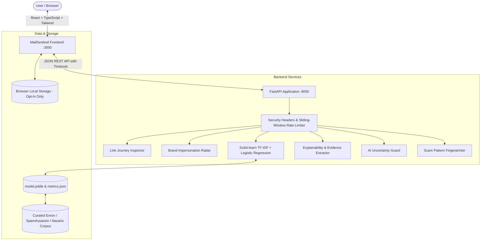

# MailSentinel AI — Email Threat Defense Platform
> **Enterprise AI-powered Fake, Spam, and Phishing Email Detection & Forensic Intelligence**

---

## 1. Project Overview
**MailSentinel AI** is a professional cybersecurity Software-as-a-Service (SaaS) web application designed for Security Operations Centers (SOCs), IT administrators, and enterprise users. It inspects inbound email payloads to classify messages into **Safe / Legitimate**, **Spam**, and **Phishing / Potentially Malicious** categories with calibrated statistical probabilities and transparent, evidence-based threat indicators.

---

## 2. Problem Statement & Objectives
Traditional rule-based email filters rely heavily on static blacklists and fragile keyword matches that attackers routinely evade using zero-width Unicode homoglyphs, newly registered domains, and linguistic urgency coercion. Conversely, black-box deep learning systems frequently offer no explainability for why an email was quarantined.

**MailSentinel AI addresses these challenges by:**
- Combining machine-learning text classification with deterministic syntactic threat heuristics.
- Providing full explainability through in-context evidence highlighting and multi-stage audit timelines.
- Eliminating overconfidence via an automated AI Uncertainty Guard.
- Protecting privacy by redacting sensitive tokens and keeping data processing local in-memory.

---

## 3. Main Features & Unique Innovations

| Feature | Description |
|---|---|
| **Email DNA Analysis** | Explains predictions by surfacing genuine threat anchors (urgency, credential harvesting, brand coercion) with interactive in-context text highlighting. |
| **AI Uncertainty Guard** | Identifies low-confidence predictions, thin probability margins, or sparse inputs, outputting *"Uncertain — verify manually"* rather than issuing misleading guarantees. |
| **Link Journey Inspector** | Safely extracts and syntactically validates hyperlinks without executing HTTP requests, detecting IP-address hosts, typosquatting, and high-risk TLDs. |
| **Brand Impersonation Radar** | Cross-references mentioned brand names against originating sender domains and flags lookalikes or free public webmail providers. |
| **Scam Pattern Fingerprinting** | Computes deterministic SHA-256 fingerprints from normalized, non-sensitive feature tiers and groups attacks into campaign clusters. |
| **Threat Story Timeline** | Records a millisecond-level step-by-step audit trail of all ingestion, inspection, and inference stages. |
| **Privacy Shield** | Enables zero-retention analysis, provides opt-in local history storage, and redacts credit cards, OTPs, and passwords from evidence previews. |
| **Security Evidence Dossier** | Generates printable reports (`window.print()`) and downloadable JSON forensic bundles for SOC escalation. |

---

## 4. Architecture & Technology Stack



- **Frontend:** React 18, TypeScript 5, Vite 5, Tailwind CSS 3, Lucide React icons.
- **Backend:** Python 3.11 / 3.13, FastAPI, Uvicorn (ASGI), Pydantic v2, Pydantic-Settings.
- **Machine Learning:** Scikit-learn (TF-IDF Vectorizer + Regularized LBFGS Logistic Regression), NumPy, Pandas, Joblib.
- **Containerization:** Multi-stage Docker, Docker Compose, Nginx Alpine.

---

## 5. Folder Structure

```text
Fake & Spam Email Classifier/
├── backend/
│   ├── app/
│   │   ├── main.py                     # FastAPI entry point, CORS, Rate Limiting & Error Handlers
│   │   ├── config.py                   # Pydantic BaseSettings, Thresholds & Monitored Brands
│   │   ├── api/v1/
│   │   │   ├── router.py               # Combined API router
│   │   │   └── endpoints/
│   │   │       ├── analyze.py          # POST /analyze & POST /analyze/batch
│   │   │       └── model_info.py       # GET /model-info
│   │   ├── middleware/
│   │   │   └── security.py             # RateLimiter, RequestSizeLimiter, SecurityHeaders
│   │   ├── ml/
│   │   │   ├── dataset.py              # Stratified dataset loader
│   │   │   ├── curated_samples.py      # Documented benchmark emails (Safe, Spam, Phish)
│   │   │   ├── evaluate.py             # Genuine classification report & confusion matrix
│   │   │   ├── train.py                # Pipeline trainer & artifact exporter
│   │   │   └── artifacts/
│   │   │       ├── model.joblib        # Fitted Scikit-learn pipeline
│   │   │       └── metrics.json        # Verified test metrics
│   │   ├── schemas/
│   │   │   ├── email.py                # Request, response, indicator & link schemas
│   │   │   └── model.py                # Governance & evaluation schemas
│   │   └── services/
│   │       ├── classifier.py           # Multi-stage orchestrator & calibrated inference
│   │       ├── explainability.py       # Rule-based threat evidence extractor
│   │       ├── link_inspector.py       # Safe static URL & syntax parser
│   │       ├── brand_radar.py          # Brand domain mismatch evaluator
│   │       ├── fingerprinter.py        # Stable non-sensitive scam pattern hasher
│   │       ├── uncertainty_guard.py    # AI confidence margin & sparsity guard
│   │       └── privacy.py              # Sensitive token & credential redactor
│   ├── data/
│   │   └── emails_dataset.csv          # Documented benchmark dataset
│   ├── tests/
│   │   ├── conftest.py                 # Pytest fixtures & TestClient setup
│   │   ├── test_api.py                 # Core API endpoint integration tests
│   │   ├── test_classifier.py          # Inference & explainability unit tests
│   │   ├── test_advanced_intelligence.py # Link, Brand, Uncertainty & Fingerprint tests
│   │   └── test_security_and_resilience.py # Rate limit, Payload size & malformed URL tests
│   ├── requirements.txt                # Python backend dependencies
│   ├── Dockerfile                      # Production backend container definition
│   └── .env.example                    # Backend environment template
├── src/
│   ├── components/
│   │   ├── common/
│   │   │   ├── Badge.tsx               # Threat verdict indicators with text labels
│   │   │   ├── Button.tsx              # Accessible button primitives
│   │   │   ├── StatCard.tsx            # Clean dashboard metrics card
│   │   │   ├── EmptyState.tsx          # Realistic empty states
│   │   │   ├── HighlightedEmailViewer.tsx # Interactive in-context evidence highlighter
│   │   │   ├── LinkInspectorView.tsx   # Safe URL inspection cards
│   │   │   ├── BrandRadarCard.tsx      # Brand impersonation detection card
│   │   │   ├── ThreatTimelineView.tsx  # Sequential audit timeline
│   │   │   └── SecurityEvidenceReportModal.tsx # Printable & exportable evidence dossier
│   │   └── layout/
│   │       ├── AppLayout.tsx           # Responsive shell layout
│   │       ├── Sidebar.tsx             # 7-view navigation bar with status pill
│   │       └── Header.tsx              # Theme toggle, live backend probe & admin pill
│   ├── context/
│   │   └── ThemeContext.tsx            # Persistent dark/light mode provider
│   ├── pages/
│   │   ├── DashboardPage.tsx           # Real-time telemetry & session stats
│   │   ├── ScanEmailPage.tsx           # Single email analyzer & intelligence explorer
│   │   ├── EmailDnaPage.tsx            # Structural fingerprint & cluster inspector
│   │   ├── ThreatIntelligencePage.tsx  # Quick domain IOC tester & feed status
│   │   ├── ScanHistoryPage.tsx         # Opt-in audit log with search, filter & purge
│   │   ├── ReportsPage.tsx             # Executive summaries & dossier generator
│   │   └── SettingsPage.tsx            # Live API probe, threshold sliders & history purge
│   ├── services/
│   │   ├── api.ts                      # Fetch client with 15s defensive timeouts
│   │   └── historyStorage.ts           # Browser localStorage manager & similarity matcher
│   ├── types/
│   │   └── index.ts                    # Complete TypeScript domain contracts
│   ├── App.tsx                         # View router
│   ├── main.tsx                        # DOM mount
│   └── index.css                       # Tailwind layers & dark scrollbars
├── Dockerfile                          # Production frontend multi-stage container
├── docker-compose.yml                  # Unified multi-container orchestration
├── package.json                        # Node manifest
├── tailwind.config.js                  # Premium navy/teal theme palette
├── tsconfig.json                       # Strict TypeScript configuration
└── vite.config.ts                      # Vite build settings
```

---

## 6. Prerequisites
- **Node.js**: v18.0.0 or higher (v20+ recommended).
- **Python**: v3.11, v3.12, or v3.13.
- **Git** (optional).
- **PowerShell** or Command Prompt on Windows.

---

## 7. Windows Setup Instructions

### Step 1: Open PowerShell in Project Root
```powershell
cd "c:\Users\parth\OneDrive\文档\Projects\Fake & Spam Email Classifier"
```

### Step 2: Initialize & Activate Virtual Environment
```powershell
python -m venv backend/venv
.\backend\venv\Scripts\Activate.ps1
```
*(If script execution is blocked on Windows, execute: `Set-ExecutionPolicy -Scope Process -ExecutionPolicy Bypass`)*

### Step 3: Install Backend Dependencies
```powershell
.\backend\venv\Scripts\python.exe -m pip install -r backend/requirements.txt
```

### Step 4: Install Frontend Dependencies
```powershell
npm install
```

---

## 8. Model Training Instructions
Train the Scikit-learn TF-IDF and regularized estimator on the documented benchmark dataset:
```powershell
$env:PYTHONIOENCODING="utf-8"
.\backend\venv\Scripts\python.exe -m backend.app.ml.train
```
- Fits `TfidfVectorizer(max_features=4000, sublinear_tf=True)`.
- Fits `LogisticRegression(class_weight="balanced")`.
- Evaluates on a stratified 25% held-out test split (Achieves ~92.3% benchmark accuracy, 92.2% macro F1).
- Serializes `model.joblib` and `metrics.json` into `backend/app/ml/artifacts/`.

---

## 9. Running the Application Locally

### Start Terminal 1 (Python FastAPI Backend)
```powershell
$env:PYTHONIOENCODING="utf-8"
.\backend\venv\Scripts\python.exe -m uvicorn backend.app.main:app --host 127.0.0.1 --port 8000 --reload
```
- **Backend API**: http://127.0.0.1:8000
- **Swagger Documentation**: http://127.0.0.1:8000/docs
- **Health Check**: http://127.0.0.1:8000/health

### Start Terminal 2 (React Frontend)
```powershell
npm run dev
```
- **Web Application**: http://localhost:3000

---

## 10. Automated Testing Commands
Run the comprehensive 25-test backend suite:
```powershell
$env:PYTHONIOENCODING="utf-8"
.\backend\venv\Scripts\python.exe -m pytest backend/tests -v
```
Test categories covered:
- Valid email classification (Safe, Spam, Phishing).
- Empty, whitespace, and oversized body input validation.
- Link Journey safe URL extraction and IP host identification.
- Brand Impersonation Radar domain matching and free webmail detection.
- AI Uncertainty Guard sparse input and narrow probability margin triggers.
- Scam pattern fingerprint consistency and cluster classification.
- Privacy Shield sensitive data redaction.
- Rate limiting and request size limit middleware (413 and 429 status codes).
- Defensive HTTP security headers (`nosniff`, `DENY`, `1; mode=block`).

Test frontend TypeScript compilation and production build:
```powershell
npm run build
```

---

## 11. Environment Variable Configuration

### Frontend (`.env`)
```bash
# Target address of the FastAPI backend service
VITE_API_URL=http://localhost:8000
```

### Backend (`backend/.env`)
```bash
APP_NAME="MailSentinel AI Backend"
APP_VERSION="1.2.0"
ENVIRONMENT="production"

# Permitted CORS Origins (JSON array or comma-separated)
CORS_ORIGINS=["http://localhost:3000","http://localhost:5173","http://127.0.0.1:3000"]

# Rate Limiting & Protection
RATE_LIMIT_PER_MINUTE=60
MAX_REQUEST_BODY_BYTES=1048576

# AI Uncertainty Guard Thresholds
UNCERTAINTY_MIN_CONFIDENCE=65.0
UNCERTAINTY_MARGIN_THRESHOLD=15.0
UNCERTAINTY_MIN_WORD_COUNT=6
```

---

## 12. Deployment Instructions

### Option A: Unified Docker Deployment (Recommended)
Deploy both frontend and backend containers simultaneously:
```bash
docker-compose up --build -d
```
- Frontend will be live on port `3000`.
- Backend will be live on port `8000`.

### Option B: Cloud Production Deployment
1. **Backend (Render / Railway / Fly.io / Cloud Run):**
   - Root directory: `./backend`
   - Build Command: `pip install -r requirements.txt && python -m backend.app.ml.train`
   - Start Command: `python -m uvicorn backend.app.main:app --host 0.0.0.0 --port $PORT`
   - Configure Environment Variables: `CORS_ORIGINS=["https://your-frontend-domain.com"]`, `ENVIRONMENT=production`.
2. **Frontend (Vercel / Netlify / Cloudflare Pages):**
   - Framework preset: `Vite`
   - Build Command: `npm run build`
   - Output Directory: `dist`
   - Configure Environment Variable: `VITE_API_URL=https://your-backend-domain.com`

---

## 13. Privacy & Security Considerations
- **No Embedded Script Execution:** Email bodies and text samples are rendered as sanitized plain strings via React JSX. No `dangerouslySetInnerHTML` is used anywhere in the codebase.
- **No Automatic Hyperlink Requests:** The Link Journey Inspector statically parses URLs with `urllib.parse`. No HTTP requests or socket connections are initiated toward suspicious target links.
- **In-Memory Ephemeral Analysis:** Inbound email text is analyzed in volatile RAM and is never written to server logs or disks.
- **Sensitive Token Masking:** Credit cards, OTPs, SSNs, and passwords are automatically masked (`[REDACTED_CARD]`) before evidence is shown in previews or exported to reports.
- **Client Storage Governance:** Analysis history is stored solely in browser `localStorage` on an explicit opt-in basis, and can be purged immediately with a single click.

---

## 14. Current Limitations & Future Improvements
1. **Cryptographic Mail Gateway Connectors:** Brand impersonation heuristics analyze text patterns and sender domains. Validating DKIM cryptographic keys and SPF TXT records requires integration with an upstream mail transfer agent (MTA).
2. **External Threat Feed Integrations:** External OSINT threat feeds (URLhaus, Spamhaus, PhishTank) are configured in transparent standby status; connecting live API keys will enable external blacklist queries.
3. **Database Integration:** Local scan history is currently governed via browser `localStorage`. A PostgreSQL schema can be mapped for multi-tenant organizational audit logging.

---

## 15. License
MIT License. Built for enterprise cybersecurity and threat analysis research.
